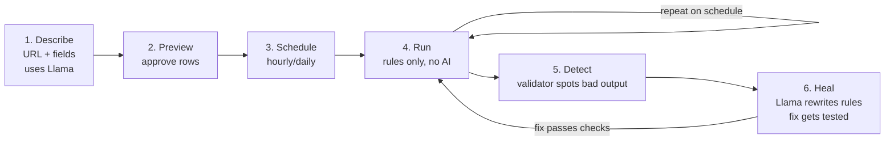
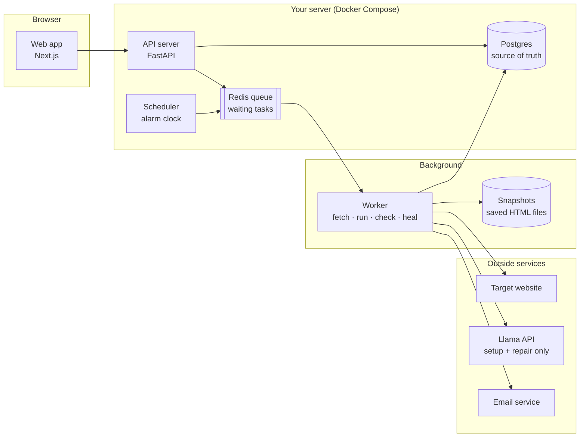
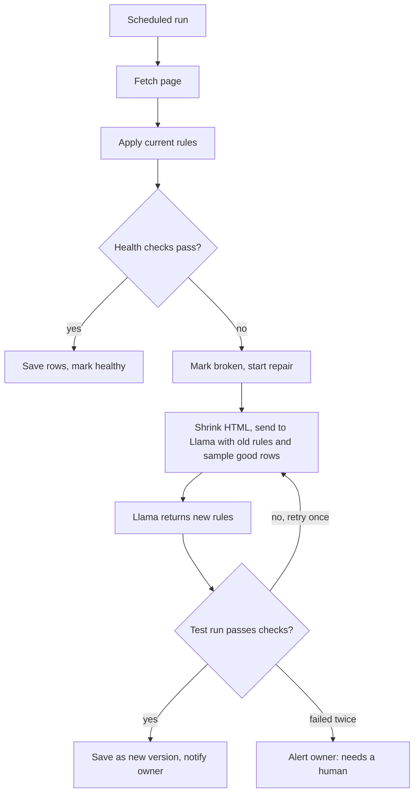
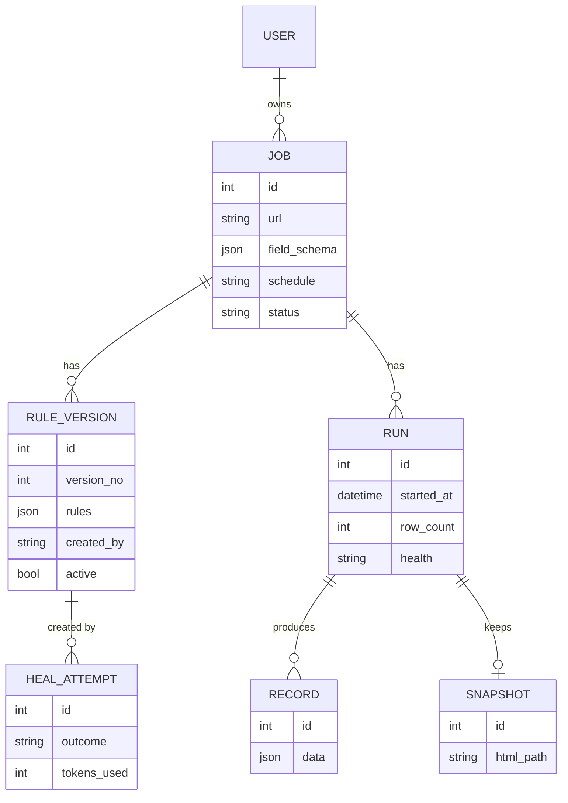

# Mender: Self-Healing Web Scrapers

Project plan and design notes, written up from the planning chat on 2026-11-15.

Visual versions (interactive diagrams):
- Project blueprint: https://claude.ai/artifact/UTyKA1zh7wo25paGLmDiht
- Architecture walkthrough (step-through scenarios): https://claude.ai/artifact/5Gojc2FjUju55Z6xHaHBCy

---

## Table of contents

1. [How we got here](#1-how-we-got-here)
2. [The one-line pitch](#2-the-one-line-pitch)
3. [The problem and why to build this](#3-the-problem-and-why-to-build-this)
4. [Who it's for](#4-who-its-for)
5. [How it works for the user](#5-how-it-works-for-the-user)
6. [Concrete example](#6-concrete-example)
7. [Architecture overview](#7-architecture-overview)
8. [Components in detail](#8-components-in-detail)
9. [Scenarios: how data flows](#9-scenarios-how-data-flows)
10. [Three ideas behind the whole design](#10-three-ideas-behind-the-whole-design)
11. [Deep dive: the Redis queue](#11-deep-dive-the-redis-queue)
12. [The hard part: detecting breaks and healing](#12-the-hard-part-detecting-breaks-and-healing)
13. [Where data lives](#13-where-data-lives)
14. [Data model](#14-data-model)
15. [API endpoints](#15-api-endpoints)
16. [Tech stack](#16-tech-stack)
17. [Running it locally and folder structure](#17-running-it-locally-and-folder-structure)
18. [Credit budget](#18-credit-budget)
19. [Build plan (phases)](#19-build-plan-phases)
20. [Scaling: what changes as it grows](#20-scaling-what-changes-as-it-grows)
21. [Resume and interview framing](#21-resume-and-interview-framing)
22. [Risks and responsible use](#22-risks-and-responsible-use)
23. [Next steps and handoff prompt](#23-next-steps-and-handoff-prompt)

---

## 1. How we got here

**Goal:** an applied AI project that runs on a limited budget of Meta Llama API credits. It should be worth building, look strong on a resume, and teach project architecture and full-stack development along the way.

**Preference:** ideas should be open-ended and new, not tailored to my current background.

Ideas considered along the way:

| Idea | Domain | One-liner |
|---|---|---|
| PDF accessibility fixer | Accessibility | Multimodal model proposes alt text, reading order and tags; a person approves; exports an accessible PDF |
| Local government watcher | Civic tech | Pull agenda items and votes out of council minutes; residents subscribe by address or topic |
| Dependency upgrade impact report | Dev tools | Match breaking changes in a library's release notes against your code's usages |
| Terms-of-service change tracker | Consumer rights | Diff policy pages over time and explain only the changes that matter |
| Spreadsheet auditor | Business tools | Dependency graph plus rule checks plus LLM explanations of spreadsheet errors |
| **Self-healing web scraper** ✅ | Data infrastructure | **AI writes extraction rules once, cheap code runs them, AI only repairs them when they break** |
| Citation checker | Research / legal | Check whether cited sources actually say what the document claims |
| Bug reproduction bot | Dev tools / agents | Agent reproduces a GitHub issue as a failing test inside a sandbox |
| Sketch-to-diagram whiteboard | Real-time collaboration | Multiplayer whiteboard; Llama vision turns sketches into clean diagrams |
| API docs from traffic | Backend | Proxy watches HTTP traffic and infers an OpenAPI spec |
| Argument mapper | Education / journalism | Turn an essay into a graph of claims, evidence and assumptions |

**Chosen: #6, the self-healing web scraper, named "Mender" (working name).**

---

## 2. The one-line pitch

You describe the data you want from a website in plain English. Mender uses Llama to write the extraction rules **once**, then runs them on a schedule with **no AI involved**. When the website changes and the rules break, Mender notices, asks Llama to rewrite them, tests the fix, and carries on.

The core idea: **use the AI to write cheap, fast, predictable code, and only call it again when that code stops working.**

---

## 3. The problem and why to build this

A lot of useful data sits on websites with no API: prices, job postings, government tenders, product listings, event calendars, research databases. People write scrapers to collect it. Scrapers depend on the page's HTML structure (e.g. `div.price-tag`), and websites redesign constantly. A scraper that worked last month quietly starts returning nothing, or worse, the wrong thing.

How people solve this today:

| Approach | Cost per run | When the site changes | Output consistency |
|---|---|---|---|
| Hand-written scraper (BeautifulSoup, Scrapy) | Near zero | Breaks silently. A developer must notice and fix it. | Exact and repeatable |
| Point-and-click scraping tools | Subscription fee | Breaks. Someone re-clicks the fields. | Exact and repeatable |
| Send every page to an LLM | One AI call per page, every run | Usually adapts | Can vary run to run, slow, expensive |
| **Mender** | **Near zero (AI only on setup and repair)** | **Detects the break and repairs itself, or alerts a human** | **Exact and repeatable between repairs** |

---

## 4. Who it's for

Anyone who needs to watch a handful to a few hundred websites for structured data and doesn't have an engineer to look after scrapers.

- **Small online sellers:** track competitor prices and stock on 20–50 product pages every day.
- **Journalists and researchers:** collect public records over time (court calendars, contract awards, housing listings, recall notices).
- **Data and analytics teams:** already run dozens of scrapers and lose hours every week fixing them. Mender turns "fix it" tickets into "approve the fix" clicks.
- **Job seekers and recruiters:** watch careers pages of companies that don't post on job boards.
- **Nonprofits and watchdogs:** monitor public dashboards (air quality, budgets, school data) and keep a history the source site doesn't keep.
- **Developers, through an API:** other apps call "give me today's rows for job 42."

---

## 5. How it works for the user



Only steps 1 and 6 use a Llama call.

---

## 6. Concrete example

A bookshop wants to track prices on a competitor's "new releases" page:

```
URL:    https://example-books.com/new-releases
Fields: title (text), author (text), price (number, in dollars), in_stock (yes/no)
Run:    every day at 7am
```

Mender fetches the page, strips scripts and styling to shrink it, and asks Llama for **extraction rules** (not the data):

```json
{
  "row_selector": "ul.book-grid > li.book-card",
  "fields": {
    "title":    { "selector": "h3.book-title",  "type": "text" },
    "author":   { "selector": "span.by-line",   "type": "text", "strip_prefix": "by " },
    "price":    { "selector": "div.price-tag",  "type": "number" },
    "in_stock": { "selector": "button.add-to-cart", "type": "exists" }
  }
}
```

Every morning a worker applies these rules with a normal HTML parser. It takes milliseconds and costs nothing.

Three months later the site is redesigned:

```html
<!-- Before -->
<li class="book-card">
  <h3 class="book-title">The Quiet River</h3>
  <div class="price-tag">$18.99</div>
</li>

<!-- After: old rules return nothing -->
<article data-testid="product">
  <a class="p-name">The Quiet River</a>
  <span class="amount">$18.99</span>
</article>
```

The validator sees 0 rows where there are usually about 40 and marks the job **broken**. It sends the new page, the old rules and a sample of last week's good data to Llama and gets new rules back. Testing them gives 41 rows, prices that parse as numbers, and titles that mostly match last week's. The fix is saved as **version 2**, and the owner is emailed: "Your job broke and was repaired. Review the change?"

---

## 7. Architecture overview



### Restaurant analogy

| Real component | Restaurant equivalent | Why |
|---|---|---|
| Web app | Dining room | Customers order here and never go into the kitchen |
| API server | Waiter | Takes the order, writes a ticket, comes back right away. Doesn't cook |
| Redis queue | Ticket rail | Orders wait in line until a cook is free |
| Workers | Cooks | Do the slow work. Hire more cooks when busy |
| Postgres | Ledger | Permanent record of every order and dish |
| Llama API | Specialist chef you call | Expensive and slow, only called when the regular recipe fails |

### Key design decisions

- **Why a queue and workers?** Fetching a page can take 10 seconds and a repair can take 30. Users should never wait on that inside a web request. The API puts a message on the queue and a worker picks it up. This is the most important pattern in the project.
- **Why store rules as JSON instead of code?** Running Python written by an AI means building a security sandbox. Selectors stored as JSON are data, not code, so they're safe to run and easy to compare between versions. Generated code can come later as an upgrade.
- **Why keep every rule version?** So you can roll back a bad repair and show users exactly what changed. People trust automation more when they can undo it.

---

## 8. Components in detail

### Web app
- **Built with:** Next.js, React, TypeScript, Tailwind
- **What it does:** the New Job form, preview table, health dashboard, and side-by-side diff of rule versions.
- **Why it exists:** it runs in the user's browser, so it can't hold secrets. It only talks to your API, never directly to Postgres or Llama.
- **Without it:** users would have to call the API by hand with curl.

### API server
- **Built with:** FastAPI, Pydantic, SQLAlchemy
- **What it does:** receives requests, checks they're valid and allowed, reads or writes Postgres, and puts slow work on the queue.
- **Why it exists:** one controlled door into the system. Login checks, input validation and rate limits live here.
- **Without it:** the browser would talk to the database directly, which is a security hole.

### Postgres
- **Built with:** Postgres 16, Alembic migrations
- **What it does:** stores users, jobs, every rule version, every run with its health, and every extracted row.
- **Why it exists:** the single source of truth. Every other part can crash and restart, and Postgres still knows the real state of everything.
- **Without it:** nothing would survive a restart, and there'd be no history, diffs or trends.

### Scheduler
- **Built with:** a small Python loop (or rq-scheduler / APScheduler)
- **What it does:** wakes every minute, finds jobs that are due, and puts a task on the queue for each.
- **Why it exists:** it decides *when* work should happen and never does the work itself, so it stays tiny and reliable.
- **Without it:** jobs would only run when someone clicked a button.

### Redis queue
- **Built with:** Redis + RQ (Python)
- **What it does:** a to-do list of tasks like `run_job(42)` or `heal_job(42)`. Workers take them off one at a time.
- **Why it exists:** it separates asking for work from doing it. The API answers instantly, and if 200 jobs come due at 7am they wait in line instead of crashing anything.
- **Without it:** the API would fetch pages during the web request, so users would wait 30 seconds and timeouts would be everywhere.

### Worker
- **Built with:** Python, httpx, Playwright, selectolax
- **What it does:** fetches the page, saves a snapshot, applies the rules, runs the health checks, and starts a repair if they fail.
- **Why it exists:** all the slow and risky work lives in one place. You can run several copies, and a crash only affects one task, which gets retried.
- **Without it:** slow work inside the API would drag the whole site down.

### Snapshots
- **Built with:** a local folder, later S3 or Cloudflare R2
- **What it does:** stores the raw HTML of each fetched page as a file. The database stores only the path.
- **Why it exists:** the healer needs the broken page to repair it, you need it for debugging, and tests can replay real pages.
- **Without it:** no record of what the page looked like when something broke.

### Target website
- The page being scraped. You don't control it, and it can change or go down at any time. It's the unreliable part the whole design protects against.

### Llama API
- **Built with:** Llama 4 through the Llama API, with JSON structured output
- **What it does:** writes extraction rules from a plain-English description and rewrites them when a page changes.
- **Why it exists:** it's the only part that understands pages the way a person does. It's also slow and costs credits, so it runs only at setup and for repairs, never on normal runs.

### Email service
- **Built with:** Resend, SendGrid, or a webhook
- **What it does:** tells the owner when a job broke, was repaired, or needs a human.
- **Why it exists:** silent failures are the problem Mender solves, so alerts are core to the product.

---

## 9. Scenarios: how data flows

### Scenario 1: Create a job

1. **User describes what they want.** On the New Job page, the user enters a URL and fields, then clicks Generate rules. *(The frontend only collects input and shows results.)*
2. **Web app → API.**
   ```
   POST /jobs
   { "url": "https://example-books.com/new-releases",
     "fields": ["title", "author", "price:number", "in_stock:bool"] }
   ```
3. **API saves a draft.** It validates the input, then saves a job row with `status = draft` and id 42. *(Validate at the door so bad input never reaches the expensive parts.)*
4. **API queues the slow part and answers right away (~40 ms).**
   ```
   queue.enqueue("generate_rules", job_id=42)
   ← 202 Accepted  { "job_id": 42, "status": "draft" }
   ```
   *(202 Accepted means "got it, still working on it.")*
5. **A worker picks up the task.** If every worker is busy, the task waits in line.
6. **The worker fetches the page and saves a snapshot** (Playwright if the page builds its content with JavaScript).
7. **The worker asks Llama to write rules.** It shrinks the HTML first (often 300 KB → 20 KB) and asks for rules, not data. *(Check the output with a Pydantic schema. If it's malformed, retry once, then fail cleanly.)*
8. **The worker test-runs the rules and saves version 1** (not active yet) along with 10 preview rows.
9. **The user reviews and approves.** The web app polls `GET /jobs/42/preview` every 2 seconds. Once rows appear, the user picks a schedule and clicks Approve, and version 1 becomes active. *(Polling is the simplest way to wait for background work. WebSockets can come later.)*

### Scenario 2: Daily run (healthy)

1. At 7:00am the scheduler finds job 42 is due.
2. The scheduler adds `run_job(42)` to the queue. If 300 jobs are due at once, they all wait their turn.
3. A free worker takes the task.
4. The worker fetches the page and saves a snapshot.
5. The worker **applies the rules with no AI**: 41 rows in about 5 ms, at zero cost. *(This is the core idea of the project.)*
6. Health check:
   ```
   row_count: 41   (recent median 40)  ✓
   price parses as number: 41/41       ✓
   required fields empty: 0%           ✓
   ```
7. One run row (`health = ok`) and 41 record rows are saved in **one transaction**, so a crash can't leave a run half-saved.
8. Later, the dashboard simply reads Postgres. It's instant and never waits on a worker.

### Scenario 3: The site changes and Mender repairs it

1. A normal run starts: scheduler → queue → worker.
2. The page loads (HTTP 200), but the HTML has changed.
3. The rules return nothing and the check fails:
   ```
   row_count: 0   (recent median 40)   ✗
   row_selector matched: 0 elements     ✗
   → verdict: BROKEN
   ```
4. The run is saved with `health = broken` and the job status changes to `healing`. Bad output is never saved as data.
5. The healer sends Llama the trimmed page, the old rules, and 5 good rows from last week, and gets candidate rules back.
6. **Test the fix before trusting it:** the normal checks run, plus a check that the output resembles last week's data. If it fails twice, stop and ask a human.
7. In one transaction: v2 becomes active, v1 stays but is turned off, and a `heal_attempt` row records the outcome and tokens used.
   ```
   rule_versions: v1 (inactive) → v2 (active, created_by=healer)
   heal_attempts: outcome=success, tokens=6,214
   ```
8. The owner is emailed with a link to the diff view.
9. The owner reviews, or rolls back with `PATCH /jobs/42/versions/1`.

### Scenario 4: A worker crashes

1. A worker runs out of memory partway through `run_job(42)` and dies. *(Assume every process will crash eventually.)*
2. The task was never marked done, so RQ moves it to the failed list and the retry policy puts it back with a delay: `Retry(max=3, interval=[30, 120, 600])`.
3. Another worker (or the restarted one) runs it from the beginning.
4. **Running it twice is safe (idempotent):** the first attempt's transaction never committed, and a unique constraint on `(job_id, scheduled_for)` prevents duplicates.
5. If all retries fail, the run is saved with `health = error` and the owner is alerted. The healer does **not** run, because the rules weren't the problem. *(Keep failure types separate: "the page didn't load" and "the rules broke" need different fixes.)*

---

## 10. Three ideas behind the whole design

1. **Separate fast work from slow work.** The API only does fast things (read the database, write a row, add a task to the queue). Anything slow goes to a worker.
   - API: save job + enqueue → 40 ms
   - Worker: fetch + Llama + test → 20 s
2. **One source of truth.** Postgres holds the real state. Redis holds temporary to-do items, and the snapshot folder holds large raw files. If Redis is wiped, nothing important is lost.
3. **Services that remember nothing.** The API and workers don't keep anything important in memory between tasks. Restart them whenever you like, and to handle more load, start more workers with no code changes.

**If you remember one thing: the API never does slow work, and normal runs never call the AI.**

---

## 11. Deep dive: the Redis queue

### The problem it solves

Without a queue:
```
User clicks "Generate rules"
   ▼
API: fetch page ........ 8 s
API: call Llama ........ 20 s
API: test rules ........ 1 s
   ▼
User gets an answer after ~30 s (or the browser times out)
```
The API is tied up the whole time, and 50 users at once would stall it.

With a queue:
```
User clicks "Generate rules"
   ▼
API: save job, add "generate_rules(42)" to the to-do list ... 40 ms
   ▼
User sees "Working on it…" immediately

      In the background:
      Worker: picks up generate_rules(42)
      Worker: fetch → Llama → test → save results to Postgres
      (web app checks every 2 s and shows results when ready)
```

**The queue is just the to-do list.** Producers (the API and scheduler) add tasks, and consumers (workers) take them off. The two sides never talk to each other directly.

### What's inside Redis
```
queue "scrape":   [ run_job(17), run_job(42), heal_job(8), run_job(91) ]
                     ▲ workers take from here                ▲ new tasks are added here
```
Each item is a small message: the function name plus its arguments. No HTML and no results; those go to the snapshot folder and Postgres.

### Code (Python + RQ)

API side, adding a task:
```python
from redis import Redis
from rq import Queue

q = Queue("scrape", connection=Redis())

@app.post("/jobs")
def create_job(body: JobIn):
    job = save_draft_job(body)                    # fast: one DB insert
    q.enqueue(generate_rules, job.id)             # fast: one Redis write
    return {"job_id": job.id, "status": "draft"}  # answers in ~40 ms
```

Worker side, doing the task:
```python
# tasks.py
def generate_rules(job_id):
    html = fetch_page(job_id)     # slow
    rules = ask_llama(html)       # slow
    save_rules(job_id, rules)     # writes to Postgres
```
Start a worker with `rq worker scrape`. It loops forever: wait for a task, run it, take the next one.

### The 7am rush (200 jobs, 2 workers)
```
7:00:00  scheduler adds 200 tasks          queue length: 200
7:00:01  worker A takes #1, worker B #2    queue length: 198
...      each takes ~3 s
7:05:00  all done
```
Too slow? Run 6 workers instead and it finishes in under 2 minutes, with no code change.

### What the queue gives you for free
- **Retries:** a crashed task gets put back on the list.
- **A buffer:** if Llama is down, repair tasks wait instead of failing.
- **Independence:** redeploy workers without touching the API, and the other way round.

### Common points of confusion

| Question | Answer |
|---|---|
| Is Redis replacing Postgres? | No. Redis is only the to-do list. If it's wiped, you lose only tasks that hadn't run yet, and the scheduler adds them again. |
| How does the user get the result? | The worker writes to Postgres. The web app polls the API, which reads Postgres. |
| Scheduler vs queue? | The scheduler is the alarm clock (*when*). The queue is where tasks *wait*. Workers are who *does* them. |
| Why RQ and not Celery or Kafka? | RQ is the simplest option in Python and fine at this size. Celery has more features and more setup. Kafka is for huge data streams and is overkill here. |

---

## 12. The hard part: detecting breaks and healing

The key interview question: how do you tell **"the scraper broke"** from **"the data really changed"**? (If a store sells out, zero items in stock is correct and shouldn't be "fixed.")

**Signals that the rules broke**
- Row count drops far below its recent normal (e.g. 40 → 0)
- A required field is suddenly empty on most rows
- Wrong types (price doesn't parse as a number)
- A selector matches nothing on the page

**Signals it's just real change**
- Shape is intact: every field present and the right type
- Row count changes gradually, within normal range
- Values change but stay plausible ($18 → $16)

**How a fix gets accepted**
- The new rules run on the current page without errors
- The output passes the same health checks
- The output resembles recent good data (same fields, overlapping values)
- If it fails after 2 attempts, stop and alert a human



---

## 13. Where data lives

| Data | Lives in | How long | Why there |
|---|---|---|---|
| Users, jobs, field lists | Postgres | Forever | Core records with relationships |
| Rule versions (v1, v2…) | Postgres, JSON column | Forever | Rollback and diff view |
| Runs and their health | Postgres | Forever (or 90 days) | Dashboard and "is this normal?" checks |
| Extracted rows | Postgres, JSON column | Forever | The product itself |
| Raw page HTML | Files on disk, later S3/R2 | 30 days | Too big for the DB; debugging and repairs |
| Pending tasks | Redis | Seconds to minutes | Fast; safe to lose |
| Schedules | Postgres, mirrored to the scheduler | Until changed | Postgres is the truth; the scheduler only reads it |
| Llama API key | Server environment variable | Until rotated | Never in the browser, never in git |

---

## 14. Data model



Notes:
- `JOB.status`: `draft` | `active` | `healing` | `needs_human` | `paused`
- `RUN.health`: `ok` | `broken` | `error` (error = fetch/infra failure, not a rules failure)
- Unique constraint on `RUN (job_id, scheduled_for)` so retries never create duplicates
- Indexes on `job_id` and `started_at` once data grows

---

## 15. API endpoints

| Method | Path | What it does | Fast or queued |
|---|---|---|---|
| POST | `/jobs` | Create a draft job from a URL and fields | Queues rule writing, returns `202` |
| GET | `/jobs/{id}` | Job details, status, current rules | Fast |
| GET | `/jobs/{id}/preview` | Sample rows from draft rules (polled) | Fast |
| POST | `/jobs/{id}/approve` | Activate rules, set schedule | Fast |
| POST | `/jobs/{id}/run` | Run now | Queued |
| GET | `/jobs/{id}/runs` | Run history with health | Fast |
| GET | `/jobs/{id}/records?since=…` | Extracted data, paginated | Fast |
| GET | `/jobs/{id}/versions` | All rule versions (diff view) | Fast |
| PATCH | `/jobs/{id}/versions/{v}` | Make an older version active (rollback) | Fast |

FastAPI generates interactive docs for these automatically at `/docs`.

---

## 16. Tech stack

| Layer | Tech | Used for |
|---|---|---|
| Frontend | Next.js, TypeScript, Tailwind | Job builder, preview, dashboard, diff viewer |
| API | FastAPI + Pydantic | REST endpoints, validation, auto docs |
| Database | Postgres + SQLAlchemy + Alembic | Relational data, JSON columns, migrations |
| Queue | Redis + RQ (or Celery) | Background jobs, retries, scheduling |
| Fetching | httpx, Playwright | Plain HTTP and headless browser |
| Parsing | selectolax or lxml | Fast CSS selector matching |
| AI | Llama API (Llama 4) | Rule generation and repair, JSON output |
| Storage | Local disk → S3 / Cloudflare R2 | HTML snapshots |
| Deploy | Docker Compose → Railway or Fly.io | Run all services together |
| Quality | pytest, GitHub Actions | Tests on every push, including the repair test suite |

The backend is Python because the best scraping and HTML tools are in Python.

---

## 17. Running it locally and folder structure

Every box in the server zone becomes a container, and `docker compose up` starts all of them. The worker and scheduler use the same Python code as the API and just start with a different command.

```yaml
# docker-compose.yml (trimmed)
services:
  web:        # Next.js
    build: ./web
    ports: ["3000:3000"]
  api:        # FastAPI
    build: ./backend
    command: uvicorn app.main:app --port 8000
    ports: ["8000:8000"]
  worker:     # same code, different command
    build: ./backend
    command: rq worker scrape heal
    deploy: { replicas: 2 }
  scheduler:
    build: ./backend
    command: python -m app.scheduler
  postgres:
    image: postgres:16
  redis:
    image: redis:7
```

```
mender/
├── web/                  → Web app
│   └── app/jobs/…        pages: list, new, detail, diff
├── backend/
│   └── app/
│       ├── main.py       → API server (routes)
│       ├── models.py     → Postgres tables
│       ├── scheduler.py  → Scheduler
│       ├── tasks/        → Worker
│       │   ├── fetch.py      fetch page, save snapshot
│       │   ├── extract.py    apply rules, no AI
│       │   ├── validate.py   health checks
│       │   └── heal.py       Llama repair loop
│       └── llm.py        → the ONLY file that calls Llama
├── testsite/             fake site you break on purpose
└── docker-compose.yml
```

Every Llama call goes through `llm.py`, so token logging, caching and model swaps all happen in one place, and it's easy to show an interviewer where the AI sits in the system.

---

## 18. Credit budget

Example: 50 websites checked every hour for a month.

| Approach | AI calls / month |
|---|---|
| LLM reads every page | 50 × 24 × 30 = **36,000** |
| Mender | ~50 setups + a few dozen repairs ≈ **~100** |

That's about 99% fewer calls. Development uses more than production because you'll be iterating on prompts, so save page snapshots and cache model responses during development.

---

## 19. Build plan (phases)

Each phase ends with something that works. AI arrives in Phase 2, so you understand the plain system first.

### Phase 1: A plain scraper with a web page (~2 weeks)
- Hand-write the rules JSON for one site
- A Python script applies the rules and saves rows to Postgres
- A FastAPI endpoint returns the rows; a simple Next.js page shows them in a table
- **You learn:** project structure, REST APIs, DB tables and migrations, frontend ↔ backend

### Phase 2: AI writes the rules (~2 weeks)
- A "describe your data" form
- Shrink the HTML, send it to Llama with the fields, get rules back as structured JSON
- A live preview the user approves
- **You learn:** prompt design, structured output and validation, handling bad responses, fitting HTML into the model's context

### Phase 3: Scheduling and background workers (~2 weeks)
- Add Redis plus workers; jobs run on their schedules
- Playwright for JavaScript-heavy sites
- Save an HTML snapshot for every run
- **You learn:** queues, async jobs, retries, timeouts, Docker Compose with several services

### Phase 4: Validation and self-healing (~3 weeks)
- Health checks, the repair loop, rule versioning
- A dashboard with healthy / broken / healing status
- Side-by-side diff of old vs new rules, and rollback
- **You learn:** the core design problem, safe automated decisions, human-review UI

### Phase 5: Prove it works, then ship (~2 weeks)
- Build a **test website you can deliberately "redesign"** (rename classes, reorder elements, wrap things in new tags)
- Run hundreds of simulated breaks and **measure the repair success rate**
- Add login, email alerts, a public API with keys, and deploy
- **You learn:** evaluating an AI system with numbers, auth, deployment, CI

Total: about 10–12 weeks part-time. Phases 1–3 alone already make a solid full-stack project.

---

## 20. Scaling: what changes as it grows

| Size | Changes |
|---|---|
| **10 jobs** | One worker; everything on one small server; snapshots on local disk |
| **1,000 jobs** | 4–8 workers; snapshots to S3/R2; DB indexes on `job_id`, `started_at`; per-site rate limits |
| **100,000 jobs** | Separate workers by type (cheap HTTP vs heavy browser); move rows to a store built for large tables; managed queue and DB |

---

## 21. Resume and interview framing

### Resume bullets (fill in the real numbers)
- Built **Mender**, a self-healing web data extraction platform (Next.js, FastAPI, Postgres, Redis, Playwright, Llama 4) that uses an LLM to generate and automatically repair scraping rules.
- Cut AI inference calls by **~99%** versus per-page LLM extraction by generating deterministic selector rules once and calling the model only on detected failures.
- Designed a validation system that separates broken extractors from genuine data changes, and repaired **X% of N** simulated site redesigns with no human input.
- Implemented versioned extraction rules with diff review and one-click rollback, plus a REST API and webhook alerts for downstream users.

### Interview stories
- **Cost:** "I didn't put the LLM in the hot path. It writes the code, and the code does the work."
- **Reliability:** how silent failures are detected, and why the system stops and asks a human instead of guessing.
- **Evaluation:** a test harness with simulated breakages and a measured success rate.

---

## 22. Risks and responsible use

- **Respect sites:** check robots.txt, rate-limit requests, identify the scraper honestly, and collect public data only. No features for getting around logins, CAPTCHAs or bot blocking.
- **Not everything is fixable:** some redesigns remove the data or put it behind a login. The healer should say so clearly instead of returning something plausible but wrong.
- **Large pages:** some pages are too big to send whole. Trim them and pick the relevant section first (Phase 2 problem).
- **Competition:** Firecrawl, Browse AI and similar tools exist. That's fine for a portfolio project. Mender's angle is deterministic rules, a measured repair rate and low cost.

---

## 23. Next steps and handoff prompt

**Immediate next step:** start Phase 1. Set up the repo skeleton (folder layout above, Docker Compose with Postgres, a FastAPI app with one `jobs` table and one endpoint, and a Next.js page that lists rows).

### Prompt to paste into a new chat

> I'm building **Mender**, a self-healing web scraper, as a learning and resume project. The full plan is in `~/Developer/Mender/MENDER_PROJECT_PLAN.md`. Please read it first.
>
> Summary: users describe the data they want in plain English, Llama 4 (via the Meta Llama API) writes CSS-selector extraction rules as JSON once, workers run those rules on a schedule with no AI, and when validation detects a break, a healer asks Llama for new rules, tests them, and saves a new version.
>
> Stack: Next.js + TypeScript + Tailwind (web), FastAPI + Pydantic + SQLAlchemy + Alembic (API), Postgres, Redis + RQ (queue/workers), httpx + Playwright + selectolax (fetch/parse), Docker Compose.
>
> I'm learning full-stack development and architecture as I go, so explain the *why* behind each step. Let's start **Phase 1**: set up the repo skeleton in `~/Developer/Mender`, Docker Compose with Postgres, a FastAPI app with a `jobs` table and a hand-written rules JSON for one test page, a script that applies the rules and saves rows, and a Next.js page that shows the rows in a table.
